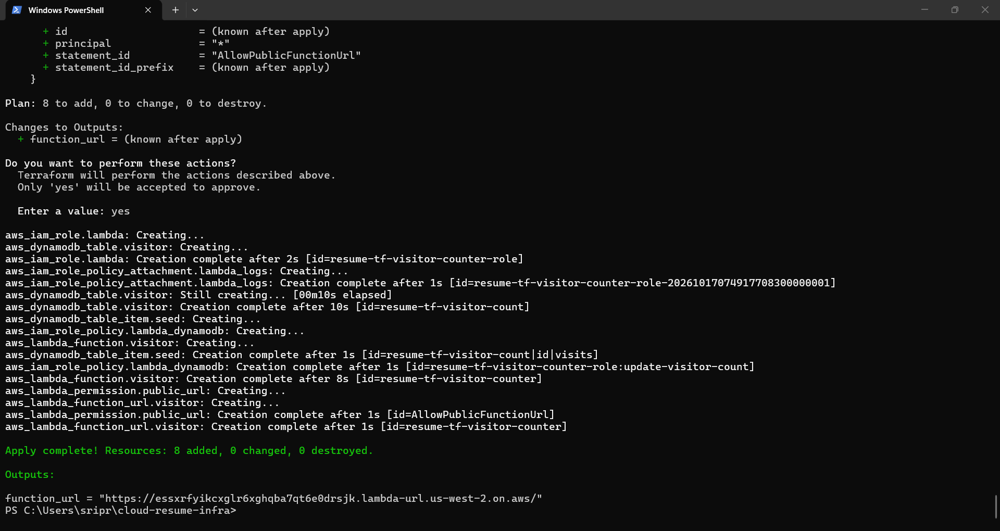
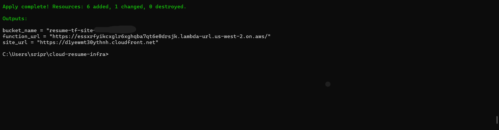

# Cloud Resume Challenge: Infrastructure (Terraform)

Terraform for the whole Cloud Resume Challenge stack on AWS, so it can be created, reviewed and destroyed with a few commands.

Related repos:
- [cloud-resume-frontend](https://github.com/prarthana2301/cloud-resume-frontend): the site and its deploy pipeline
- [cloud-resume-backend](https://github.com/prarthana2301/cloud-resume-backend): Lambda code, tests and deploy pipeline

## What it builds

- **DynamoDB** table for the visitor count, with a seeded `visits` item
- **Lambda** function (Python 3.12) with a **Function URL**, an IAM role limited to `dynamodb:UpdateItem` on that one table, and CloudWatch logging
- **S3** bucket (private, public access blocked)
- **CloudFront** distribution with Origin Access Control, so only CloudFront can read the bucket
- The portfolio `index.html`, uploaded with the Lambda URL swapped in, so the copy works end to end

Everything is prefixed `resume-tf-`, so it runs next to the hand-built version without clashing.

## Usage

Needs Terraform 1.5 or newer and the AWS CLI configured. The three repos must sit side by side, because Terraform reads the Lambda code from `../cloud-resume-backend/src` and the page from `../cloud-resume-frontend/index.html`.

```
terraform init
terraform plan
terraform apply
terraform destroy   # remove everything when done
```

State is stored locally and is not committed.

## Screenshots

| Backend apply | Site apply |
|---|---|
|  |  |

## What I learned

- A public Lambda Function URL needs two permissions, `InvokeFunctionUrl` and `InvokeFunction` (scoped with `invoked_via_function_url`). With only the first one, the URL returned Forbidden.
- Reading `terraform plan` carefully matters. One edit showed the working permission being destroyed and replaced, so I fixed the file before applying.
- Terraform state files can hold sensitive values, so they stay out of Git and I keep a backup.

## Next steps

- Move state to an S3 backend with locking
- Manage the GitHub Actions OIDC roles in Terraform
- Add a custom domain with Route 53 and ACM